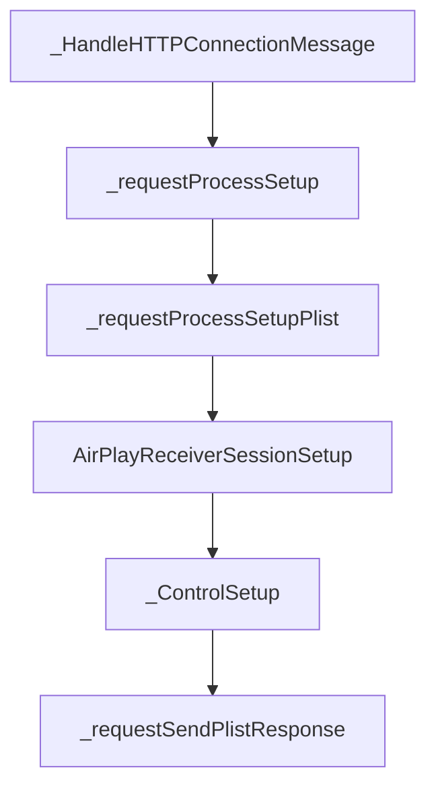
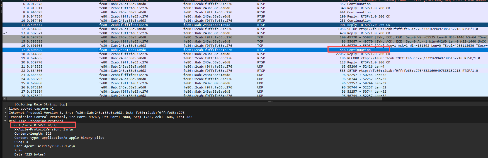
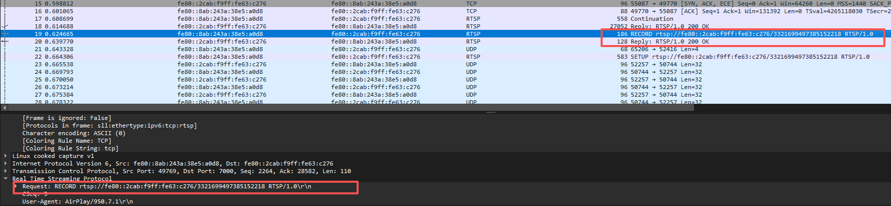

# `AirPlay` 信令解析

## 首次 `RTSP` `SETUP` 信令

```txt
python parse_setup_pcap.py hostapd11_decrypted.pcap
共 6 条 SETUP

======== SETUP #1  CSeq=3  2026-08-04T02:40:09.519 ========
fe80:0:0:0:8ab:243a:38e5:a0d8:49769 -> fe80:0:0:0:2cab:f9ff:fe63:c276:7000
SETUP rtsp://fe80::2cab:f9ff:fe63:c276/3321699497385152218 RTSP/1.0
请求 plist:
{
  "name": "胃袋有点大的IPhone",
  "updateSessionRequest": false,
  "statsCollectionEnabled": true,
  "sessionUUID": "2E190C18-003C-4EDA-A001-2608A5A4BA88",
  "osName": "iPhone OS",
  "keepAliveLowPower": true,
  "features": [
    "uiContext",
    "viewAreas",
    "cornerMasks",
    "focusTransfer",
    "h.264Level5.1",
    "mainBuffered",
    "altScreen",
    "enhancedSiri",
    "hevc",
    "vehicleStateProtocol",
    "sessionManagement",
    "videoPlayback",
    "logTransfer",
    //这个 iAPChannel 相对之前是新的Feature.
    "iAPChannel"
  ],
  "osBuildVersion": "23F84",
  "timingPort": 50744,
  "sourceVersion": "950.7.1",
  "osVersion": "26.5.2",
  "sessionCorrelationUUID": "D7F75517-3F90-4D59-89CA-541E7CD3C9EF",
  "internalBuild": false,
  "deviceID": "fc:9c:a7:26:26:a4",
  "diagnosticsAndUsage": true,
  "model": "iPhone15,4",
  "macAddress": "76:0B:66:52:2F:42"
}
Reply 2026-08-04T02:40:09.587: RTSP/1.0 200 OK
响应 plist:
{
  "keepAlivePort": 52416,
  "eventPort": 55087,
  "timingPort": 52257,
  "enabledFeatures": [
    "altScreen",
    "enhancedSiri",
    "uiContext",
    "viewAreas",
    "cornerMasks",
    "hevc",
    "h.264Level5.1",
    "mainBuffered",
    "sessionManagement",
    "logTransfer",
    "iAPChannel"
  ]
}
```

这里编写脚本来解析 `SETUP`信令的 `plist` 协商具体的信息。这里暂时不关注其他信息，仅仅关注 `request` 和 `response` 的 `socket` 的相关的信息。可以看到手机给过来 ` timingPort` 是 `50744`。 而车机回复了三个 `tcp` 或者 `udp` 的端口信息，即  `keepAlivePort - 52416` ，`eventPort - 55087`，`timingPort - 52257`

### AirPlay 协议栈 如何处理 `SETUP` 信令

`SETUP` 信令处理流程如下：



```c
static OSStatus _HandleHTTPConnectionMessage(HTTPConnectionRef inCnx, HTTPMessageRef inRequest, void *inContext)
{
    ....
    
    //这里可以看到，明显AirPlay协议栈要求所有RTSP处理都是需要在Pair-verify和Auth-setup之后。
    if (!cnx->pairingVerified && ((strnicmpx(methodPtr, methodLen, "POST") != 0) || ((strnicmp_suffix(pathPtr, pathLen, "/pair-setup") != 0) && (strnicmp_suffix(pathPtr, pathLen, "/pair-verify") != 0) && (strnicmp_suffix(pathPtr, pathLen, "/auth-setup") != 0))))
    {
        aprs_ulog(kLogLevelNotice, "### Unverified RTSP request denied: %.*s %.*s\n",
                  (int)methodLen, methodPtr, (int)pathLen, pathPtr);
        _requestReportIfIncompatibleSender(cnx, inRequest);
        //返回未授权
        status = kHTTPStatus_Unauthorized;
        goto SendResponse;
    }
    
    if (strnicmpx(methodPtr, methodLen, "OPTIONS") == 0)
        status = _requestProcessOptions(cnx);
    else if (strnicmpx(methodPtr, methodLen, "FLUSH") == 0)
        status = _requestProcessFlush(cnx, inRequest);
    else if (strnicmpx(methodPtr, methodLen, "RECORD") == 0)
        status = _requestProcessRecord(cnx, inRequest);
    else if (strnicmpx(methodPtr, methodLen, "SETUP") == 0)
        
      	//处理 Rtsp Setup
        status = _requestProcessSetup(cnx, inRequest);
    
    ...
}
```


`_HandleHTTPConnectionMessage` 这个函数即处理所有的 `RTSP`信令的入口。这里去比对 `method` 的名称，如果方法名称是 `SETUP` ，那么就得就将这次请求交给的 `_requestProcessSetup` 去处理。

```c
static HTTPStatus _requestProcessSetup(AirPlayReceiverConnectionRef inCnx, HTTPMessageRef inRequest)
{
    ···
    if (MIMETypeIsPlist(ptr, len))
    {
        
        status = _requestProcessSetupPlist(inCnx, inRequest);
        goto exit;
    }
    ···
}
```

`_requestProcessSetup`  函数比较简单，直接判断传递过来的参数  `MIME` 类型是否是 `Plist` 类型， 是直接调用 `_requestProcessSetupPlist` 继续处理携带的参数。


```c
static HTTPStatus _requestProcessSetupPlist(AirPlayReceiverConnectionRef inCnx, HTTPMessageRef inRequest)
{
    ....

    u64 = CFDictionaryGetMACAddress(requestParams, CFSTR(kAirPlayKey_DeviceID), NULL, &err);
    if (!err)
        inCnx->clientDeviceID = u64;

    strlcpy(inCnx->ifName, inCnx->httpCnx->ifName, sizeof(inCnx->ifName));

    CFDictionaryGetMACAddress(requestParams, CFSTR(kAirPlayKey_MACAddress), inCnx->clientInterfaceMACAddress, &err);

    CFDictionaryGetCString(requestParams, CFSTR(kAirPlayKey_Name), inCnx->clientName, sizeof(inCnx->clientName), NULL);

    CFDictionaryGetData(requestParams, CFSTR(kAirPlayKey_SessionUUID), sessionUUID, sizeof(sessionUUID), &len, &err);
    
    ....
        
    if (features)
    {
        //解析features
    }
    
  	....
    
    //创建 session
	err = _requestCreateSession(inCnx, true, sessionCorrelationUUID);
    
    //初始化 AirPlayReceiverSession 
    err = AirPlayReceiverSessionSetup(inCnx->session, requestParams, &responseParams);
    
    //返回好初始化好的 plist回复。
    status = _requestSendPlistResponse(inCnx->httpCnx, inRequest, responseParams, &err);
    
    ....
}
```

`_requestProcessSetupPlist` 中会对携带 `Plist` 进行解析，之后调用 `_requestCreateSession` 创建 `session`，`AirPlayReceiverSessionSetup` 建立 `AirPlaySession`，最终将`AirPlaySession` 的一些信息返回走 `RTSP` 返回给手机。

`_requestCreateSession`

```
static OSStatus
_requestCreateSession(
    AirPlayReceiverConnectionRef inCnx,
    Boolean                      inUseEvents,
    CFStringRef                  inSessionCorrelationUUID)
{
 	.....
    err = AirPlayReceiverSessionCreate(&inCnx->session, &createParams);
    require_noerr(err, exit);
	....

exit:
    return (err);
}
```

`_requestCreateSession` 调用 `AirPlayReceiverSessionCreate` ， 这里不展开看源码了，需要知晓的是，`AirPlayReceiverSessionCreate` 里面初始化了`AirPlayReceiverSessionRef` 对象，初始化 `queue` 等等。

> 所以从 `AirPlay` 协议栈代码来看，`AirPlayReceiverSession` 对象的创建是第一次接收到 `POST SETUP`。

下面详细了解下：`AirPlayReceiverSessionSetup` 做了些什么操作，上面 `keepAlivePort` ，`eventPort`，`timingPort` 这些 `socket` 如何创建

```c
AirPlayReceiverSessionSetup(
    AirPlayReceiverSessionRef me,
    CFDictionaryRef           inRequestParams,
    CFDictionaryRef          *outResponseParams)
{    
    ....
    
    if (!me->controlSetup)
    {
        err = _ControlSetup(me, inRequestParams, responseParams);
        require_noerr(err, exit);
		....
    }

    
}
```

`AirPlayReceiverSessionSetup` 涉及到 `socket` 这些控制端口逻辑被封装在 `_ControlSetup`，剩下逻辑涉及到具体  `stream` 的创建，这个在后续`stream`创建章节进行具体分析。

```c
static OSStatus
_ControlSetup(
    AirPlayReceiverSessionRef inSession,
    CFDictionaryRef           inRequestParams,
    CFMutableDictionaryRef    inResponseParams)
{
    ....
    //创建时间同步socket.
    err = _TimingInitialize(inSession);
    require_noerr(err, exit_unlock_teardown);
    CFDictionarySetInt64(inResponseParams, CFSTR(kAirPlayKey_Port_Timing), inSession->timingPortLocal);

    if (CFDictionaryGetBoolean(inRequestParams, CFSTR(kAirPlayKey_KeepAliveLowPower), NULL))
    {
        // Supports receiving UDP beacon as keep alive.
		
        //创建保活keepAlive的socket
        err = _IdleStateKeepAliveInitialize(inSession);
        require_noerr(err, exit_unlock_teardown);
        CFDictionarySetInt64(inResponseParams, CFSTR(kAirPlayKey_Port_KeepAlive), inSession->keepAlivePortLocal);
    }

    if (inSession->useEvents)
    {
        //创建了eventSocket的tcp socket,
        err = ServerSocketOpenEx3(SOCK_STREAM, IPPROTO_TCP,
                                  inSession->server->ifname, -kAirPlayPort_RTSPEvents,
                                  &inSession->eventPort, kSocketBufferSize_DontSet,
                                  CUServerSocketFlagsNone, &inSession->eventSock);
        require_noerr(err, exit_unlock_teardown);

        CFDictionarySetInt64(inResponseParams, CFSTR(kAirPlayKey_Port_Event), inSession->eventPort);

        atr_ulog(kLogLevelTrace, "Events set up on port %d\n", inSession->eventPort);
    }
    ....
}
```

```c
static OSStatus _TimingInitialize(AirPlayReceiverSessionRef inSession)
{
    OSStatus    err;
    sockaddr_ip sip;

    // Set up a socket to send and receive timing-related info.

    SockAddrCopy(&inSession->peerAddr, &sip);
    //这里创建了UDP的socket， 这个socket端口会给 timingSock 去使用
    err = ServerSocketOpenEx3(SOCK_DGRAM, IPPROTO_UDP,
                              inSession->server->ifname, -kAirPlayPort_TimeSyncClient,
                              &inSession->timingPortLocal, kSocketBufferSize_DontSet,
                              CUServerSocketFlagsNone, &inSession->timingSock);
}
```

```c
static OSStatus _IdleStateKeepAliveInitialize(AirPlayReceiverSessionRef inSession)
{
    OSStatus err;

    check(!IsValidSocket(inSession->keepAliveSock));

    // Set up a socket to receive udp keep alive beacon.
    
    //这里创建了UDP的socket， 这个socket端口会给 keepAliveSock 去使用
    err = ServerSocketOpenEx3(SOCK_DGRAM, IPPROTO_UDP,
                              inSession->server->ifname, -kAirPlayPort_KeepAlive,
                              &inSession->keepAlivePortLocal, kSocketBufferSize_DontSet,
                              CUServerSocketFlagsNone, &inSession->keepAliveSock);
}
```


从上面函数调用的角度来看，`_ControlSetup` 创建了对应端口的 `socket`， 均是使用 `ServerSocketOpenEx3` 创建。其中 `keepAlivePort` `timingPort` 是 `udp`   套接字，`eventPort` 是 `tcp` 套接字。


> 这里需要注意一点，`eventPort` 在这个阶段仅仅是创建一个**被动套接字**，只有在`RECORD`信令之后经过 `accept` 之后变成主动套接字之后才能发送信令给到手机。


从上述的手机发过来`RTSP SETUP` 信令。可以知道这个过程中车机侧主要的做了创建 `AirPlayReceiveSessionRef` 对象、初始化 `Socket` 等等。


## `RTSP` `GET` 信令

在接收到 `RTSP SETUP` 之后，手机侧下一步会发起一个`RTSP GET`，并且携带的参数为 `/info`



编写解析 `GET` 信令的 `py` 脚本。

`python parse_get_pcap.py hostapd11_decrypted.pcap`

下面是执行 `py` 脚本之后打印。

```txt
python parse_get_pcap.py hostapd11_decrypted.pcap
共 2 条 GET

======== GET #1  CSeq=4  2026-08-04T02:40:09.613 ========
fe80:0:0:0:8ab:243a:38e5:a0d8:49769 -> fe80:0:0:0:2cab:f9ff:fe63:c276:7000
GET /info RTSP/1.0
请求 plist:
{
  "altScreenURLs": [
    "maps:/car/instrumentcluster/map",
    "maps:/car/instrumentcluster/instructioncard",
    "maps:/car/instrumentcluster"
  ],
  "uiContextURLs": [
    "maps:",
    "mobilephone:",
    "nowplaying:",
    "messages:"
  ],
  "stopSessionReasons": [
    1,
    2
  ]
}

Reply 2026-08-04T02:40:09.619: RTSP/1.0 200 OK
Content-Type: application/x-apple-binary-plist
响应 plist:
{
  "pi": "5c71bca2-da58-4c9e-a0d1-677685380f52",
  "firmwareRevision": "Overseas.sw.1.0",
  "OSInfo": "",
  "uiContextNowOnDisplayURLs": [
    "nowplaying:",
    "maps:"
  ],
  "modes": {
    "appStates": [
      {
        "appStateID": 2,
        "state": false
      },
      {
        "speechMode": -1,
        "appStateID": 1
      },
      {
        "appStateID": 3,
        "state": false
      }
    ],
    "resources": [
      {
        "transferPriority": 500,
        "takeConstraint": 100,
        "resourceID": 1,
        "transferType": 1,
        "borrowConstraint": 100
      },
      {
        "transferPriority": 100,
        "takeConstraint": 100,
        "resourceID": 2,
        "transferType": 1,
        "borrowConstraint": 100
      }
    ],
    "initialPermanentEntity": [
      {
        "permanentEntity": 1,
        "resourceID": 1
      },
      {
        "permanentEntity": 2,
        "takeConstraint": 100,
        "resourceID": 2,
        "borrowConstraint": 100
      }
    ]
  },
  "oemIcon": {
    "_bytes": 3484,
    "hex": "...."
  },
  "manufacturer": "",
  "audioLatencies": [
    {
      "inputLatencyMicros": 20000,
      "audioType": "compatibility",
      "type": 100,
      "outputLatencyMicros": 35000,
      "typeName": "MainAudio"
    },
    {
      "inputLatencyMicros": 20000,
      "audioType": "default",
      "type": 100,
      "outputLatencyMicros": 35000,
      "typeName": "MainAudio"
    },
    {
      "audioType": "media",
      "type": 100,
      "outputLatencyMicros": 35000,
      "typeName": "MainAudio"
    },
    {
      "inputLatencyMicros": 20000,
      "audioType": "telephony",
      "type": 100,
      "outputLatencyMicros": 35000,
      "typeName": "MainAudio"
    },
    {
      "inputLatencyMicros": 20000,
      "audioType": "speechRecognition",
      "type": 100,
      "outputLatencyMicros": 35000,
      "typeName": "MainAudio"
    },
    {
      "audioType": "alert",
      "type": 100,
      "outputLatencyMicros": 35000,
      "typeName": "MainAudio"
    },
    {
      "audioType": "compatibility",
      "type": 101,
      "outputLatencyMicros": 35000,
      "typeName": "AltAudio"
    },
    {
      "audioType": "default",
      "type": 101,
      "outputLatencyMicros": 35000,
      "typeName": "AltAudio"
    },
    {
      "audioType": "media",
      "type": 102,
      "outputLatencyMicros": 35000,
      "typeName": "MainHighAudio"
    },
    {
      "inputLatencyMicros": 20000,
      "audioType": "speechRecognition",
      "type": 107,
      "typeName": "AuxInAudio"
    },
    {
      "audioType": "speechRecognition",
      "type": 106,
      "outputLatencyMicros": 35000,
      "typeName": "AuxOutAudio"
    },
    {
      "audioType": "media",
      "type": 103,
      "outputLatencyMicros": 35000,
      "typeName": "BufferedAudio"
    }
  ],
  "keepAliveLowPower": true,
  "displayPanels": [
    {
      "initialVideoStreams": [
        {
          "zIndex": 1,
          "originXPixels": 0,
          "uuid": "e5f7a68d-7b0f-4305-984b-974f677a150c",
          "originYPixels": 0
        }
      ],
      "widthPixels": 2560,
      "properties": [],
      "heightPhysical": 194,
      "heightPixels": 1440,
      "widthPhysical": 345,
      "uid": "Center_Display"
    },
    {
      "initialVideoStreams": [
        {
          "zIndex": 1,
          "originXPixels": 0,
          "uuid": "e5f7a68d-7b0f-4305-984b-b051a776f479",
          "originYPixels": 0
        }
      ],
      "widthPixels": 1920,
      "properties": [
        "showsInstruments"
      ],
      "heightPhysical": 55,
      "heightPixels": 480,
      "widthPhysical": 219,
      "uid": "Cluster_Display"
    },
    {
      "initialVideoStreams": [
        {
          "zIndex": 0,
          "originXPixels": 0,
          "uuid": "e5f7a68d-7b0f-4305-984b-b051a776f481",
          "originYPixels": 0
        }
      ],
      "widthPixels": 800,
      "properties": [],
      "heightPhysical": 60,
      "heightPixels": 480,
      "widthPhysical": 100,
      "uid": "Hud_Display"
    }
  ],
  "model": "",
  "buttonInfo": [
    {
      "buttonLocation": 0,
      "buttonPressDuration": 0,
      "buttonType": 0
    }
  ],
  "hardwareRevision": "Overseas.hw.1.0",
  "keepAliveSendStatsAsBody": true,
  "mainBufferedInfo": {},
  "iAPChannelInfo": {},
  "audioFormats": [
    {
      "audioInputFormats": 84,
      "audioOutputFormats": 34900,
      "audioType": "compatibility",
      "type": 100,
      "typeName": "MainAudio"
    },
    {
      "audioOutputFormats": 34816,
      "audioType": "compatibility",
      "type": 101,
      "typeName": "AltAudio"
    },
    {
      "audioOutputFormats": 1073776640,
      "audioType": "alert",
      "type": 100,
      "typeName": "MainAudio"
    },
    {
      "audioInputFormats": 805306448,
      "audioOutputFormats": 805306448,
      "audioType": "default",
      "type": 100,
      "typeName": "MainAudio"
    },
    {
      "audioOutputFormats": 34816,
      "audioType": "media",
      "type": 100,
      "typeName": "MainAudio"
    },
    {
      "audioInputFormats": 1879048528,
      "audioOutputFormats": 1879048528,
      "audioType": "telephony",
      "type": 100,
      "typeName": "MainAudio"
    },
    {
      "audioInputFormats": 536870976,
      "audioOutputFormats": 536870976,
      "audioType": "speechRecognition",
      "type": 100,
      "typeName": "MainAudio"
    },
    {
      "audioOutputFormats": 1073776640,
      "audioType": "default",
      "type": 101,
      "typeName": "AltAudio"
    },
    {
      "audioOutputFormats": 12582912,
      "audioType": "media",
      "type": 102,
      "typeName": "MainHighAudio"
    },
    {
      "audioOutputFormats": 12582912,
      "audioType": "media",
      "type": 103,
      "typeName": "BufferedAudio"
    },
    {
      "audioOutputFormats": 1073758208,
      "audioType": "speechRecognition",
      "type": 106,
      "typeName": "AuxOutAudio"
    },
    {
      "audioInputFormats": 268435472,
      "audioType": "speechRecognition",
      "type": 107,
      "typeName": "AuxInAudio"
    }
  ],
  "logTransferInfo": {},
  "rightHandDrive": false,
  "extendedFeatures": [
    "vocoderInfo"
  ],
  "uiContextLastOnDisplayURLs": [
    "maps:",
    "mobilephone:",
    "messages:",
    "nowplaying:"
  ],
  "sessionManagementInfo": {
    "stopSession": true
  },
  "statusFlags": 4,
  "hevcInfo": {},
  "oemIconVisible": true,
  "bluetoothIDs": [
    "30:4A:C4:D4:58:F3"
  ],
  "altScreenSuggestUIURLs": [
    "maps:/car/instrumentcluster/map",
    "maps:/car/instrumentcluster/instructioncard"
  ],
  "deviceID": "53:19:59:6C:C8:36",
  "nightMode": false,
  "displays": [
    {
      "mapAppearanceSetting": 2,
      "widthPixels": 2560,
      "uiAppearanceMode": 0,
      "zoomFactor": 1.0,
      "primaryInputDevice": 1,
      "heightPhysical": 166,
      "heightPixels": 1232,
      "uiAppearanceSetting": 1,
      "uuid": "e5f7a68d-7b0f-4305-984b-974f677a150c",
      "type": 110,
      "mapAppearanceMode": 1,
      "cornerMasks": true,
      "widthPhysical": 345,
      "maxFPS": 60,
      "features": 8,
      "typeName": "MainScreen"
    },
    {
      "mapAppearanceSetting": 0,
      "widthPixels": 1920,
      "uiAppearanceMode": 0,
      "zoomFactor": 1.0,
      "heightPhysical": 55,
      "heightPixels": 480,
      "uiAppearanceSetting": 0,
      "initialViewArea": 0,
      "uuid": "e5f7a68d-7b0f-4305-984b-b051a776f479",
      "type": 111,
      "mapAppearanceMode": 0,
      "adjacentViewAreas": [],
      "widthPhysical": 219,
      "maxFPS": 60,
      "viewAreas": [
        {
          "heightPixels": 480,
          "originXPixels": 0,
          "safeArea": {
            "widthPixels": 762,
            "heightPixels": 292,
            "originYPixels": 76,
            "originXPixels": 624
          },
          "originYPixels": 0,
          "widthPixels": 1920
        }
      ],
      "typeName": "AltScreen"
    },
    {
      "mapAppearanceSetting": 0,
      "widthPixels": 800,
      "uiAppearanceMode": 0,
      "heightPhysical": 60,
      "heightPixels": 480,
      "uiAppearanceSetting": 0,
      "initialViewArea": 0,
      "uuid": "e5f7a68d-7b0f-4305-984b-b051a776f481",
      "type": 111,
      "mapAppearanceMode": 0,
      "adjacentViewAreas": [],
      "widthPhysical": 100,
      "maxFPS": 60,
      "viewAreas": [
        {
          "heightPixels": 480,
          "originXPixels": 0,
          "safeArea": {
            "widthPixels": 300,
            "heightPixels": 212,
            "originYPixels": 108,
            "originXPixels": 190
          },
          "originYPixels": 0,
          "widthPixels": 800
        }
      ],
      "typeName": "AltScreen"
    }
  ],
  "hidDevices": [
    {
      "hidProductID": 16641,
      "hidCountryCode": 0,
      "uuid": "0",
      "hidDescriptor": {
        "_bytes": 107,
        "hex": "....",
        "b64": "...."
      },
      "displayUUID": "e5f7a68d-7b0f-4305-984b-974f677a150c",
      "hidVendorID": 10685,
      "name": "Multi-Touch"
    },
    {
      "hidProductID": 16641,
      "hidCountryCode": 0,
      "uuid": "1",
      "hidDescriptor": {
        "_bytes": 25,
        "hex": "050b0907a10115002502050b090009200926750895018100c0",
        "b64": "BQsJB6EBFQAlAgULCQAJIAkmdQiVAYEAwA=="
      },
      "displayUUID": "e5f7a68d-7b0f-4305-984b-974f677a150c",
      "hidVendorID": 10685,
      "name": "Telephony Buttons"
    },
    {
      "hidProductID": 16641,
      "hidCountryCode": 0,
      "uuid": "2",
      "hidDescriptor": {
        "_bytes": 37,
        "hex": "050c0901a10115002505050c0a00000ab0000ab1000acd000ab5000ab600750895018100c0",
        "b64": "BQwJAaEBFQAlBQUMCgAACrAACrEACs0ACrUACrYAdQiVAYEAwA=="
      },
      "displayUUID": "e5f7a68d-7b0f-4305-984b-974f677a150c",
      "hidVendorID": 10685,
      "name": "Media Buttons"
    }
  ],
  "oemIconLabel": "MG",
  "sourceVersion": "510.1",
  "features": 416679199360,
  "oemIcons": [
    {
      "widthPixels": 120,
      "prerendered": true,
      "heightPixels": 120,
      "imageData": {
        "_bytes": 3971,
        "hex": "...."
      }
    },
    {
      "widthPixels": 180,
      "prerendered": true,
      "heightPixels": 180,
      "imageData": {
        "_bytes": 6001,
        "hex": "...."
      }
    },
    {
      "widthPixels": 256,
      "prerendered": true,
      "heightPixels": 256,
      "imageData": {
        "_bytes": 9128,
        "hex": "...."
      }
    }
  ],
  "enhancedSiriInfo": {
    "voiceModelCurrentLanguage": "en-US",
    "supportedSiriTriggerZones": 1,
    "enhancedSiriButton": true,
    "enhancedSiriVoice": true,
    "voiceModelSupportedLanguages": [
      "en-US",
      "fr-CA"
    ]
  },
  "name": "CarPlay"
}
```

上述是完整关于 `RTSP GET` 携带参数的处理，上述省略了关于图标的二进制数据。`GET info` 就是手机请求 `CarPlay Session` 的一些信息。

### `AirPlay` 协议栈如何处理 `GET` 信令

可以看到当`RTSP Server GET`并且携带的参数是 `/info` 之后，会将接收到命令之后交给 `_requestProcessInfo` 来处理。

```c
if (0)
{ }
else if (strnicmp_suffix(pathPtr, pathLen, "/info") == 0)
    status = _requestProcessInfo(cnx, inRequest);
else if (strnicmp_suffix(pathPtr, pathLen, "/logs") == 0)
    status = _requestProcessGetLogs(cnx, inRequest);
else
{
    dlog(kLogLevelNotice, "### Unsupported GET: '%.*s'\n", (int)pathLen, pathPtr);
    status = kHTTPStatus_NotFound;
}	
```

`_requestProcessInfo` 中回复手机的逻辑均定义在 `AirPlayCopyServerInfo` 中。

```c
responseDict = AirPlayCopyServerInfo(inCnx->session, qualifier, &err);
```

这个部分就是对应着文档中对于 **`Info Message`** 的描述，源码角度即在 `_requestProcessInfo` 和 `AirPlayCopyServerInfo`做的处理。

## `RTSP` `RECORD` 信令

上述分析角度来看，`SETUP` 信令 实际上并没有启动一个 `Session` ，AirPlay 协议栈源码中不会在 `SETUP`启动一个Session，其过程是在处理 `RECORD` 信令的时候去启动的。



`_requestProcessRecord` 是处理`RTSP RECORD` 信令的入口。

```c
//===========================================================================================================================
//	_requestProcessRecord
//===========================================================================================================================

static HTTPStatus _requestProcessRecord(AirPlayReceiverConnectionRef inCnx, HTTPMessageRef inRequest)
{
    HTTPStatus                      status;
    OSStatus                        err;
    const char                     *src;
    const char                     *end;
    size_t                          len;
    const char                     *namePtr;
    size_t                          nameLen;
    const char                     *valuePtr;
    size_t                          valueLen;
    AirPlayReceiverSessionStartInfo startInfo;

    aprs_ulog(kAirPlayPhaseLogLevel, "Record\n");
    require_action(inCnx, exit, status = kHTTPStatus_InternalServerError);
    require_action(inCnx->session, exit, status = kHTTPStatus_InternalServerError);

    //这里可以看到Record 必须是要在 setup信令的处理之后才有效果。
    if (!AirPlayReceiverConnectionDidSetup(inCnx))
    {
        dlogassert("RECORD not allowed before SETUP");
        status = kHTTPStatus_MethodNotValidInThisState;
        goto exit;
    }

    memset(&startInfo, 0, sizeof(startInfo));
    startInfo.clientName    = inCnx->clientName;
    startInfo.transportType = inCnx->httpCnx->transportType;

    // Start the session. 开启AirPlaySession
    err = AirPlayReceiverSessionStart(
        inCnx->session,
        &startInfo);

#if (TARGET_OS_POSIX)
    err = NetworkChangeListenerCreate(&inCnx->networkChangeListener);
    require_noerr_action(err, exit, status = kHTTPStatus_InternalServerError);
    NetworkChangeListenerSetDispatchQueue(inCnx->networkChangeListener, AirPlayReceiverServerGetDispatchQueue(inCnx->server));
    NetworkChangeListenerSetHandler(inCnx->networkChangeListener, _requestNetworkChangeListenerHandleEvent, inCnx);
    NetworkChangeListenerStart(inCnx->networkChangeListener);
#endif

    inCnx->didRecord = true;
    status           = kHTTPStatus_OK;

exit:
    return (status);
}
```

`_requestProcessRecord` 中调用了 `AirPlayReceiverSessionStart ` 去启动了一个 `AirPlayReceiverSession`

```c
OSStatus
AirPlayReceiverSessionStart(
    AirPlayReceiverSessionRef        inSession,
    AirPlayReceiverSessionStartInfo *inInfo)
{
    OSStatus          err;
    dispatch_source_t source;
    uint64_t          nanos;

    require_action(inSession, exit, err = kParamErr);

    EventLoggerBegin("SessionStart", "Begin");

    inSession->playTicks = UpTicks();

    if (IsValidSocket(inSession->eventSock))
    {
        //调用 _ControlStart 去启动socket相关，这里主要去启动了 event socket。将event socket封装为 一个 HTTPclient, 并且设置了密钥。
        
        err = _ControlStart(inSession);
        require_noerr(err, exit);
    }

    err = AirPlayReceiverSessionPlatformControl(inSession, kCFObjectFlagDirect, CFSTR(kAirPlayCommand_StartSession),
                                                NULL, NULL, NULL);
    require_noerr_quiet(err, exit);
    
    //这里才真正的设置sessionStarted 为true，这里才真正的认为AirPlayReceiverSession被启动。
    inSession->sessionStarted = true;

    if (inSession->delegate.started_f)
    {
        //回调预先设置的函数指针。
        inSession->delegate.started_f(inSession, inSession->delegate.context);
    }

    if (!AirPlayAccessoryEnabledFeatureIAP(inSession->connection) && inSession->delegate.iAP2Started_f)
    {
        inSession->delegate.iAP2Started_f(inSession, inSession->delegate.context);
    }

    // Start a timer to service things periodically.

    //这里下面还启动了一个定时任务，相隔 250ms 去执行 `_PerformPeriodTasks` 函数，而这个函数中就有keepliveSocket 心跳机制的判断。
    inSession->source.lastIdleLogTicks = inSession->playTicks;
    inSession->periodicTimer = source = dispatch_source_create(DISPATCH_SOURCE_TYPE_TIMER, 0, 0, inSession->queue);
    require_action(source, exit, err = kUnknownErr);
    dispatch_set_context(source, inSession);
    dispatch_source_set_event_handler_f(source, _PerformPeriodTasks);
    nanos = 250 * kNanosecondsPerMillisecond;
    dispatch_source_set_timer(source, dispatch_time(DISPATCH_TIME_NOW, nanos), nanos, nanos);
    dispatch_resume(source);

exit:
    EventLoggerEnd("SessionStart", "End delta ms=%llu", UpTicksToMilliseconds(UpTicks() - inSession->playTicks));
    _LogStarted(inSession, inInfo, err);
    return (err);
}
```

## 非首次 `RTSP` `SETUP` 信令

这里将 `RTSP SETUP` 分成首次和非首次，是为了更加好了解 `AirPlay` 协议栈在连接时的流程，因为交互过程中手机会多次发送 `SETUP` 信令给到 `AirPlayServer`， 在首次 `RTSP SETUP` 可以发现，并没有携带任何关于 `stream` 的 `Request`以及`Response Plist`参数，但是

`AirPlayReceiverSessionSetup` 在对 `AirPlayReceiverSession` 进行处理，在首次时仅仅关注了 `_ControlSetup`，其他的逻辑， 并没有去关注的，后续手机还会多次发送 `RTSP SETUP` 信令。


```txt
======== SETUP #2  CSeq=6  2026-08-03T19:31:24.934 ========
fe80:0:0:0:10df:543:29b8:25d2:49219 -> fe80:0:0:0:2cab:f9ff:fe63:c276:7000
SETUP rtsp://fe80::2cab:f9ff:fe63:c276/13237314634063892279 RTSP/1.0
请求 plist:
{
  "streams": [
    {
      "controlType": 2,
      "channelID": "53:19:59:6C:C8:36-RCS-17",
      "seed": -2394351712473156240,
      "clientUUID": "726C1A55-4769-4741-AE55-1F693DAAE2FC",
      "type": 130,
      "wantsDedicatedSocket": true,
      "sendMessageAsIs": true,
      "clientTypeUUID": "E9459FD0-BCAD-4C45-820F-1E72447EF2F2",
      "typeName": "DataStream"
    }
  ]
}
Reply 2026-08-03T19:31:24.996: RTSP/1.0 200 OK
响应 plist:
{
  "streams": [
    {
      "streamID": 1,
      "type": 130,
      "dataPort": 52397,
      "typeName": "DataStream"
    }
  ]
}

======== SETUP #3  CSeq=12  2026-08-03T19:31:25.670 ========
fe80:0:0:0:10df:543:29b8:25d2:49219 -> fe80:0:0:0:2cab:f9ff:fe63:c276:7000
SETUP rtsp://fe80::2cab:f9ff:fe63:c276/13237314634063892279 RTSP/1.0
请求 plist:
{
  "streams": [
    {
      "controlType": 2,
      "channelID": "53:19:59:6C:C8:36-RCS-18",
      "seed": -7682569675175502218,
      "clientUUID": "923B2DFB-71B1-45E9-9EC1-4CCC43D52103",
      "type": 130,
      "wantsDedicatedSocket": true,
      "sendMessageAsIs": true,
      "clientTypeUUID": "75AD9926-4777-42B2-A7D8-823EBEECF7AA",
      "typeName": "DataStream"
    }
  ]
}
Reply 2026-08-03T19:31:25.704: RTSP/1.0 200 OK
响应 plist:
{
  "streams": [
    {
      "streamID": 2,
      "type": 130,
      "dataPort": 53235,
      "typeName": "DataStream"
    }
  ],
  "timingPort": 54579
}
```

### `Data Stream` 建立

这个部分相对于 `(R17) SDK`  处存在差异，`DataStream`  是新加的机制，之前 `Apple SDK` 中是没有关于`DataStream`的特性，`NextGeneration`中增加了`iAPFeature` 这个特性。在  `iAPFeature` 之前均是通过 `7000` 这个 `POST /command` 来传输数据的。

`AirPlay` 协议栈在接收 `Record`信令之后，还接收到多个 `SETUP` 信令。

`AirPlayReceiverSessionSetup` 对于  `Stream`  的处理。

```c
requestStreams = CFDictionaryGetCFArray(inRequestParams, CFSTR(kAirPlayKey_Streams), &err);
streamCount    = requestStreams ? CFArrayGetCount(requestStreams) : 0;
if (streamCount > 0)
{
    err = _ControlIdleStateTransitionActive(me, responseParams);
    require_noerr(err, exit);
}

for (streamIndex = 0; streamIndex < streamCount; ++streamIndex)
{
    CFStringRef audioType;

    requestStreamDesc = CFArrayGetCFDictionaryAtIndex(requestStreams, streamIndex, &err);
    require_noerr(err, exit);

    //从请求的 plist 中获取到 Stream 的 type 字段。
    type      = (AirPlayStreamType)CFDictionaryGetInt64(requestStreamDesc, CFSTR(kAirPlayKey_Type), NULL);
    audioType = CFDictionaryGetCFString(requestStreamDesc, CFSTR(kAirPlayKey_AudioType), NULL);
    if (IsStreamTypeAudio(type) && type != kAudioStreamType_AuxInAudio)
    {
        if (me->delegate.audioSetup_f)
        {
            me->delegate.audioSetup_f(me, type, audioType, me->delegate.context);
        }
    }

    EventLoggerBegin("StreamSetupRequest", "Begin Type: %s", AirPlayStreamTypeToString(type));
    streamSetupTicks = UpTicks();

    //对于这个type，对于不同的type执行不同的逻辑。
    switch (type)
    {
    case kAirPlayStreamType_MainHighAudio:
    case kAirPlayStreamType_MainAudio:
    case kAirPlayStreamType_AltAudio:
    case kAirPlayStreamType_AuxInAudio:
    case kAirPlayStreamType_AuxOutAudio:
    case kAirPlayStreamType_BufferedAudio:
        err = _AudioSetup(me, type, requestStreamDesc, responseParams);
        require_noerr(err, exit);
        break;

    case kAirPlayStreamType_MainScreen:
    case kAirPlayStreamType_AltScreen:
        err = _ScreenSetup(me, requestStreamDesc, responseParams);
        require_noerr(err, exit);
        break;

    case kAirPlayStreamType_DataStream:
        err = _DataStreamSessionSetup(me, requestStreamDesc, responseParams);
        require_noerr(err, exit);
        break;

    default:
        atr_ulog(kLogLevelNotice, "### Unsupported stream type: %d\n", type);
        break;
    }
}

```

`AirPlay` 对于 `type` 做了定义，`type = 130` 即表示这个 `Stream`是一个数据流。数据流其中也进行具体的细分。后续使用 `clientTypeUUID` 来区分数据流的作用是什么。

```c
#define kAirPlayDataStreamUUID_iAP         "E9459FD0-BCAD-4C45-820F-1E72447EF2F2"
#define kAirPlayDataStreamUUID_LogTransfer "75AD9926-4777-42B2-A7D8-823EBEECF7AA"
#define kAirPlayDataStreamUUID_VehicleDataProtocol1 "3E2F3C61-AAD0-42CB-A8AA-BF22186DA62E"
#define kAirPlayDataStreamUUID_VehicleDataProtocol2 "FF4A6720-F2BE-4F56-A3E1-DB3B4E37D634"
#define kAirPlayDataStreamUUID_FileTransfer "09A8AA2D-8932-4048-9492-6B658D42C2A3"
#define kAirPlayDataStreamUUID_UISync       "07D9F906-8D64-4B54-A808-A20BCA2C51C2"
#if AIRPLAY_RECEIVER_UI
#define kAirPlayDataStreamUUID_MediaRemote    "1910A70F-DBC0-4242-AF95-115DB30604E1"
#define kAirPlayDataStreamUUID_UrlFling       "A6B27562-B43A-4F2D-B75F-82391E250194"
#define kAirPlayDataStreamUUID_OverlayUI      "E3DC3EA6-E6C3-4B30-847C-B7ACFEBEA654"
#define kAirPlayDataStreamUUID_SenderSettings "BB493F61-A6B8-4769-8D74-80C23A9F71C4"
```

`"clientTypeUUID": "75AD9926-4777-42B2-A7D8-823EBEECF7AA"`   --- 创建了一个 `logTransfer` 的`data stream`

`"clientTypeUUID": "E9459FD0-BCAD-4C45-820F-1E72447EF2F2"` --- 创建了一个 `IAP2` 的`data stream`

数据流的处理将会在 `_DataStreamSessionSetup` 中处理。


`_DataStreamSessionSetup` 中 回去调用  `AirPlayReceiverSessionDataStreamCreate`  中调用 `APMediaDataControlServerCreate` `APMediaDataControlServerCreate` 中创建  `dataStream `的 `TCP` 端口。`AirPlayReceiverSessionDataStreamStart` 中监听 `TCP` 端口的监听。

```c
APMediaDataControlServerCreate()
    
OSStatus APMediaDataControlServerCreate(
    ...
        
	//为数据流创建了一个TCP 端口监听
    err = ServerSocketOpenEx3(SOCK_STREAM, IPPROTO_TCP, inIfName, port, &server->listenPort, kSocketBufferSize_DontSet, CUServerSocketFlagsNone, &server->listenSock);
	.....
}
```

`AirPlayReceiverSessionDataStreamStart` 会调用 `controlServer_startInternal`，当存在 `read` 事件之后，会调用`controlServer_acceptConnection`这个方法。

```c
static void controlServer_acceptConnection(void *inContext)
{	
    //从主动套接字中accept一个套接字连接。
    ....
    err = SocketAccept(server->listenSock, kAPMediaDataControlAcceptConnectionTimeoutSecs, &newSock, &sockAddr);
    ....
    //从对端socket读取数据，读取的数据将交给 controlServer_receiveData 处理。
    dispatch_source_set_event_handler_f(dataSource, controlServer_receiveData);
	....
}
```

`controlServer_receiveData` 方法通过回调 `queue` 调用 `deleget` 事先注册的 `receiveData` 函数指针。

>这里 `dataStream` 和 `event` 是两个不同` tcp`，所以之前在`event` 更新的事件流和 `dataStream `的  `fileTransform` 会存在时序问题，本质上就是两个不同的tcp链路，而且从理论时序上来说，`event` 的 `accept`是在我们  `record`  信令接收之后就会 `accept` ，而 `fileTransform` 的数据流是在`record`启动`AirPlaySession` 之后。


### `Screen Stream` 建立

`SETUP` 还会去建立 `Screen Stream`。

```txt
======== SETUP #6  CSeq=16  2026-08-03T19:31:26.719 ========
fe80:0:0:0:10df:543:29b8:25d2:49219 -> fe80:0:0:0:2cab:f9ff:fe63:c276:7000
SETUP rtsp://fe80::2cab:f9ff:fe63:c276/13237314634063892279 RTSP/1.0
请求 plist:
{
  "streams": [
    {
      "streamConnectionID": 8563321836790891304,
      "topLeftCornerMask": {
        "_bytes": 4224,
        "hex": "..."
      },
      "latencyMs": 75,
      "type": 110,
      "uuid": "e5f7a68d-7b0f-4305-984b-974f677a150c",
      "typeName": "MainScreen"
    }
  ]
}
Reply 2026-08-03T19:31:26.721: RTSP/1.0 200 OK
响应 plist:
{
  "streams": [
    {
      "type": 110,
      "dataPort": 52617,
      "typeName": "MainScreen"
    }
  ]
}
```

上述这个即为 `7000 Port` 上关于视频 `Stream` 的 `SETUP` 的 `Plist` 解析。关于视频流是如何处理，这个部分在 `AirPlay`视频流解析 做出的详细解释，这里先略过不在展开。


